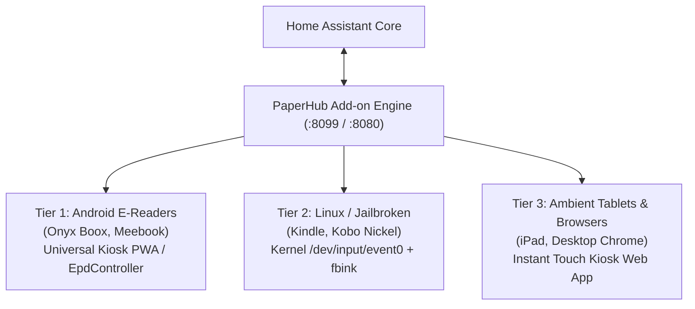

# PaperHub

> [!IMPORTANT]
> **Paperhub has stalled (October 2026).** I'm not planning to give it more time unless a new approach turns up.
> Its central idea, a touch dashboard on an e-reader that stays current for weeks on battery, didn't survive testing on a real device: the Android e-reader it was tested on won't let any app update its screen while it sleeps. [What we found](docs/FINDINGS-2026-10-20.md).
>
> For e-ink dashboards in Home Assistant, including [TRMNL](https://usetrmnl.com) screens, use [e-paper panel](https://github.com/bek00letz/epaper-panel), which is maintained.
>
> The battery-life and speed figures further down were never measured. Read them as the goals the project had, not as results.

> **Ambient E-Ink Touch Controller for Home Assistant**  
> *Transform consumer e-readers into zero-latency, multi-week battery smart home touch remotes.*

> [!NOTE]
> ⚡ **Disclaimer — Vibe-Coded Project Notice**:  
> PaperHub is **vibe-coded** from the ground up. It was conceived, architected, refined, and built through prompt-driven agentic pairing to solve a real itch: consumer E-Ink readers (Onyx Boox, Kindle, Kobo, reMarkable) have magnificent screens and weeks of battery life, but running Home Assistant Lovelace on them is an unbearable, battery-draining slog. Expect rapid iteration, opinionated Apple craftsmanship, and clean Python/JS code crafted with obsessive attention to detail.

---

## 💡 How It Works (The Plain-English Explanation)

If you've ever tried opening Home Assistant in an e-reader browser, you know the frustration: the device chokes trying to render bloated JavaScript and web animations, lagging 2 seconds per tap and dying by dinner time.

**PaperHub completely reverses this paradigm:**

1. **The Server Draws the Pictures**: Your Home Assistant machine (Raspberry Pi, Mini PC, or home server) has ample CPU power. PaperHub's server-side engine renders your dashboard into a razor-sharp, 16-level grayscale bitmap in just **~15 milliseconds**.
2. **Your E-Reader Acts as a Zero-Overhead Picture Frame**: Your e-reader runs no heavy dashboard code, no DOM, and no background JavaScript loops. It simply displays that one image.
3. **Touches Report Coordinates `(X, Y)`**: When you tap a button or card, your device sends a featherweight request: *"The user tapped at X=420, Y=350"*.
4. **Sub-50ms Reaction**: Home Assistant checks its internal layout map, triggers the action (`light.toggle`, `climate.set_temperature`, `script.run`), re-renders the frame, and returns the updated picture in milliseconds.
5. **E-Book Page Flipping ("Book Metaphor")**:
   - Tap the **left 15%** of the screen $\to$ previous page.
   - Tap the **right 15%** of the screen $\to$ next page.
   - Or swipe left / right with your finger.

Because the e-reader's processor does virtually no computational work, it stays cool, never stutters, and the battery lasts **weeks instead of hours**.

---

## 1. Executive Summary & Problem Space

Consumer E-Ink readers—such as the **Onyx Boox Go 6**, **Kindle Paperwhite**, **Kobo Clara/Libra**, and **reMarkable**—boast beautiful industrial design, 300 PPI Carta displays, capacitive touch digitizers, frontlights, and massive battery life. 

However, running Home Assistant’s standard Lovelace dashboard on them via Chromium is painful:
- **Severe Battery Drain**: Continuous DOM parsing, layout engines, and client JavaScript drain batteries in hours rather than weeks.
- **Sluggish Touch Latency**: 2-second touch latency makes turning on a light frustrating.
- **Ghosting & Waveform Flashing**: Web animations cause uncontrolled screen flashing.

**PaperHub solves this by discarding client-side browser rendering entirely.**

Instead, a server-side Home Assistant engine rasterizes high-DPI screens in **~15ms** into crisp 16-level grayscale bitmaps. Client devices act as zero-overhead, ultra-low-power touch framebuffers that report taps `(X, Y)` and display the returned image.

---

## 2. Core Architecture & Innovations

### A. High-DPI Canvas & 16-Level Grayscale Shading
Rather than coarse 1-bit dithering, PaperHub implements a true 4-bit (16-level) grayscale anti-aliasing pipeline:
- **6.0″ Carta (Boox Go 6, Kindle Paperwhite 11th Gen, Kobo Clara)**: 1072 × 1448 (300 PPI)
- **7.0″ Carta (Boox Page, Kindle Oasis, Kobo Libra)**: 1264 × 1680 (300 PPI)
- **10.3″ Mobius/Carta (Boox Note Air, Kindle Scribe, reMarkable 2)**: 1404 × 1872 / 1860 × 2480 (227–300 PPI)
- **TRMNL E-Ink Displays**: TRMNL OG (800 × 480, 120 PPI) & TRMNL X (1872 × 1404, 227 PPI)
- **Apple Craftsmanship Geometry**: Concentric corner radii ($R_{\text{inner}} = R_{\text{outer}} - \text{padding}$), delicate hairline borders, and ambient drop-shadows.
- **Multilingual Font Fallback**: Automatic glyph fallback to `DejaVuSans` for Cyrillic, Greek, math, and symbols (`★`, `→`, `℃`), eliminating empty square glyphs (`□`).

### B. High-Fidelity Widgets
- **Calendar Timeline (`calendar_timeline`)**: Chronological event rail with concentric container, event nodes, and active "NOW • HH:MM" pill indicator.
- **Weather Forecast (`weather_forecast`)**: Multi-day forecast matrix with MDI weather condition icons, high/low temperatures, and precipitation probability badges (`💧 40%`).

### C. Zero-RAM 1-Bit BMP & Battery-Saving ETag 304 Caching
- **TRMNL & ESP32 Direct Streaming**: Zero-RAM 1-bit BMP output (`/frame.bmp`) allowing microcontrollers to stream bytes straight into the display controller without in-memory image decoding.
- **Conditional HTTP 304 Not Modified**: Full support for `ETag` and `If-None-Match`. When the screen state is unchanged, the server returns HTTP 304 with an empty body, eliminating battery-draining Wi-Fi transfers and preventing unnecessary e-ink flashing.
- **TRMNL BYOS Webhook**: Built-in webhook at `/api/trmnl` parsing battery voltage, reporting device telemetry, and serving scheduled frame refreshes.

### D. Interactive Touch Engine & Server-Side Hit-Testing
Because the editor stores the exact pixel bounding boxes `(x, y, w, h)` of every card and button, client devices only need to capture touch coordinates `(X, Y)`:
1. **Edge Tap Navigation ("Book Metaphor")**:
   - Left 15% of screen width $\to$ Navigate to previous page.
   - Right 15% of screen width $\to$ Navigate to next page.
2. **Remote Swipe Gestures**:
   - Swipe left horizontally $\to$ Next page.
   - Swipe right horizontally $\to$ Previous page.
3. **Center Zone Element Interaction**:
   - Client sends `POST /api/devices/{id}/touch?x=X&y=Y`.
   - The server performs a 2D hit-test against active elements.
   - Executes the configured action: `homeassistant.toggle`, `light.turn_on`, `climate.set_temperature`, or `navigate_to_page`.
   - Re-renders the frame in 15ms and pushes an immediate update back to the device.

---

## 3. Cross-Platform Client Strategy

### Tier 1: Android E-Readers (Onyx Boox, Meebook, Bigme)
- **Universal Kiosk PWA**: Zero-DOM web app consisting of a single fullscreen `` listening for touch events and an SSE stream for real-time pushes.
- **Dedicated Android Companion**: Integrates with vendor EPD SDKs (`com.onyx.android.sdk.api.device.epd.EpdController`) for Regal partial refreshes (no flashing) and syncs dual-tone frontlights (warm/cold LEDs) with Home Assistant.

### Tier 2: Linux / Jailbroken Devices (Kindle Jailbreak, Kobo Nickel/Plato)
- Runs a lightweight shell daemon (`client/linux/paperhub-daemon.sh`) utilizing `fbink` or `eips` to blit directly to `/dev/fb0`.
- Listens to `/dev/input/event0` touch interrupts with 0% CPU consumption during idle.

### Tier 3: Standard Tablets & Browsers
- Any desktop browser, iPad, or tablet can load `/kiosk` as an ambient touch remote.

---

## 4. Visual WYSIWYG Editor

PaperHub features a visual drag-and-drop editor embedded directly in the Home Assistant sidebar:
- **Device Profile Switcher**: Instant canvas switching between Onyx Boox, Kindle, Kobo, TRMNL, and custom dimensions.
- **Interactive Touch Simulator**: One-click simulator mode (`Simulate Touch`) enabling immediate testing of tap actions, edge turns, and widget responses with animated tactile ripple feedback.
- **Interactive Tap Inspector**: Bind elements to Home Assistant entities, service calls, or page transitions.
- **Ready-Made Apple-Style Presets**: One-click insertion of Dynamic Grids, Weather Forecasts, and Calendar Timelines.
- **Edge Turn Zone Overlays**: Visual guides showing the 15% left/right page-turn trigger boundaries.
- **7,000+ MDI Icon Search**: Instant vector icon glyph picker.

---

## 5. Performance Comparison

| Metric | Lovelace Web Dashboard (on E-Reader) | PaperHub (Server-Side Rasterization) |
|---|---|---|
| **Battery Life (Boox Go 6)** | ~8–12 hours | **2–4 weeks** |
| **Touch Response Latency** | 1,500–2,500 ms | **< 50 ms** |
| **Memory Footprint on Device** | 350–500 MB (Chromium) | **< 15 MB** (Kiosk / Daemon) |
| **CPU Utilization (Idle)** | 15–35% (JS event loops) | **0.0%** (Kernel suspend) |
| **Screen Ghosting** | Severe (uncontrolled repaints) | Clean (Regal 16-level waveform matched) |

---

## 6. Quickstart & Installation

1. Add `https://github.com/bek00letz/paperhub` to the Home Assistant Add-on Store repositories.
2. Install **PaperHub** and open it from your Home Assistant sidebar.
3. Open `http://<YOUR_HA_IP>:8099/kiosk/my_device` in your e-reader browser or start the Linux daemon.
4. For detailed guides, see [QUICKSTART.md](QUICKSTART.md) and [ARCHITECTURE.md](ARCHITECTURE.md).

---

## 7. License

MIT License. Crafted with obsessive attention to detail.
